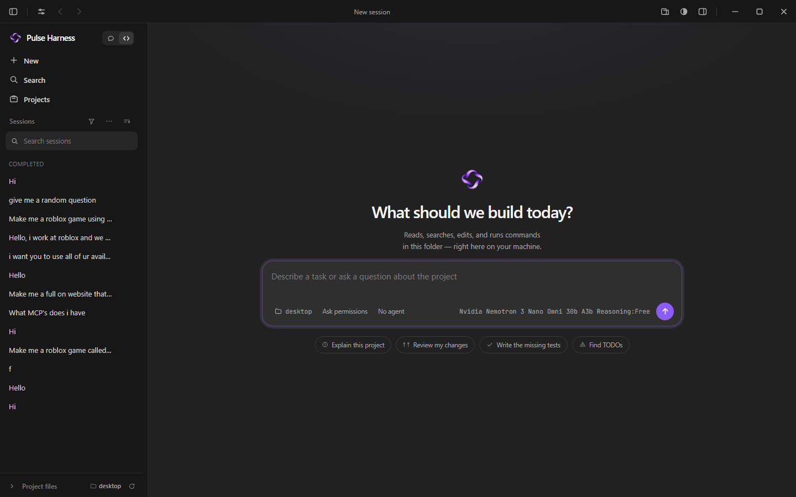
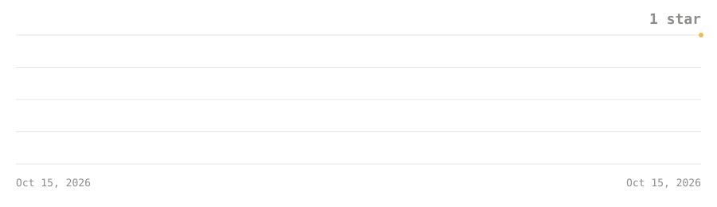

<div align="center">


# Pulse Harness

**A local, provider-agnostic agentic coding tool — the Pulse Harness desktop app and the Star Code CLI.**

Bring your own model. Pulse Harness reads, searches, edits and runs commands in your project — and asks before it touches anything.

[](https://github.com/Star-Code-Prod/Pulse-Harness/releases) [](https://github.com/Star-Code-Prod/Pulse-Harness/actions/workflows/build.yml) [](https://github.com/Star-Code-Prod/Pulse-Harness/blob/main/desktop/LICENSE) [](https://github.com/Star-Code-Prod/Pulse-Harness)



**Website:** https://star-code-prod.github.io/Pulse-Harness/

</div>

---

Pulse Harness is the harness, not the model: the tools, the permission model, the diff review, the desktop shell. Bring your own (DeepSeek, OpenAI, Anthropic, Ollama, LM Studio, or any OpenAI-compatible endpoint) — including a model running on your own machine. The desktop app is **Pulse Harness**; the terminal CLI is **Star Code**. Both share the same agent loop, web UI, tools and credential store — and the CLI needs no server at all.

- **No telemetry, no accounts.** Your key goes to your provider, nothing else.
- **No cloud.** The server runs on `127.0.0.1` and dies with the app.
- **Real tools**, not a chat wrapper: it actually reads and writes your files.

## Install

### Prebuilt

Grab an installer from [Releases](https://github.com/Star-Code-Prod/Pulse-Harness/releases):

| Platform | File |
|---|---|
| Windows | `Pulse-Harness-Setup-<version>.exe` (installer) or `Pulse-Harness-<version>-x64.exe` (portable) |
| Windows (CLI) | `Star-Code-CLI-<version>.exe` — standalone `star-code`, no Node needed |
| macOS | `Pulse-Harness-<version>-arm64.dmg` |
| Linux | `Pulse-Harness-<version>-x86_64.AppImage` or `Pulse-Harness-<version>-amd64.deb` |
| CLI (Node 18+) | `star-code-cli-<version>.tgz` (or `.zip`) |

Builds are unsigned, so your OS will warn you on first launch.

### From source

```bash
git clone https://github.com/Star-Code-Prod/Pulse-Harness.git
cd Pulse-Harness/desktop
npm install
npm run electron      # the Pulse Harness desktop app
npm start             # server + UI: http://127.0.0.1:4180
npm run web           # web version: prints http://127.0.0.1:<port> and opens it
```

On Windows you can also double-click `desktop\start.bat` — it uses Electron when present and falls back to the browser when it isn't.

### The `pulse` command

The Windows installer adds a `pulse` shim to the per-user `WindowsApps` folder, which is already on PATH:

```powershell
pulse web
```

That starts the installed app in web mode, prints `http://127.0.0.1:<port>`, and opens it.

From a source checkout, install the npm bin once:

```bash
cd Pulse-Harness/desktop
npm install -g .
pulse web
```

`pulse web --port 5000`, `--root "C:\path\to\project"` and `--no-open` work the same as `npm run web`.

### Star Code (CLI)

The `.tgz` installs the `star-code` command; the `.zip` runs as-is. From the source tree:

```bash
cd CLI
npm i -g .        # installs the `star-code` command
star-code "fix the failing test"
```

## Setup

1. Open **Settings** (`Ctrl+,`) → **Providers** — or type `/connect`
2. Pick a provider, paste its API key, hit **Connect**. It validates against the provider and shows the real error if anything is wrong
3. Choose a model with the picker (`/models`) — the list comes from the provider itself, so it is exactly what your key can use
4. Click the folder chip in the chat header and type the folder to work in — there is no project picker to pass. The composer's `+` menu, `/commands` and `@` file mentions all work the same in any session

Ollama, LM Studio and vLLM need no setup: if one is running it shows up as **Detected** and its models join the picker.

Credentials live on this machine in `~/.star-code/auth.json` (or `$STAR_CODE_DATA`), written `0600` where the OS supports it. Environment variables (`OPENAI_API_KEY`, `ANTHROPIC_API_KEY`, …) are honored as a fallback. Keys only ever go to the provider they belong to.

### Providers

| Provider | Base URL | Env var |
|---|---|---|
| OpenAI | `https://api.openai.com/v1` | `OPENAI_API_KEY` |
| Anthropic | `https://api.anthropic.com/v1` | `ANTHROPIC_API_KEY` |
| DeepSeek | `https://api.deepseek.com` | `DEEPSEEK_API_KEY` |
| Google (Gemini) | `https://generativelanguage.googleapis.com/v1beta/openai` | `GEMINI_API_KEY` / `GOOGLE_API_KEY` |
| xAI (Grok) | `https://api.x.ai/v1` | `XAI_API_KEY` |
| Groq | `https://api.groq.com/openai/v1` | `GROQ_API_KEY` |
| Mistral | `https://api.mistral.ai/v1` | `MISTRAL_API_KEY` |
| OpenRouter | `https://openrouter.ai/api/v1` | `OPENROUTER_API_KEY` |
| Together | `https://api.together.xyz/v1` | `TOGETHER_API_KEY` |
| Ollama | `http://localhost:11434/v1` | local, detected — no key |
| LM Studio | `http://localhost:1234/v1` | local, detected — no key |
| vLLM | `http://localhost:8000/v1` | local, detected — no key |
| Custom | any | `CUSTOM_API_KEY` |

The **base URL is per provider and fully honored** — point it at a proxy or a local model server under *Advanced* and it uses that. The context limit per provider (and per model) is a real setting: Star budgets against the value your provider actually enforces, with a per-provider override when you know better.

## Features

| | |
|---|---|
| **Core tools** | `read_file` `list_dir` `search_files` `glob_files` `write_file` `edit_file` `multi_edit` `run_command` `download` `search_knowledge` `task` `fetch_url` `websearch` `self_knowledge` `ask_user` `skill` `use_folder` |
| **Power tools** | Beyond the core set: `git_status` `git_diff` `git_log` `git_commit` · `test_run` (the project's own verify/test script, PASS/FAIL with the tail) · `office_read` `office_write` (real .docx/.xlsx/.pptx, written then read back) · `memory` (preferences that survive sessions) · `template` (house style) · `chart` (bar/line/pie to SVG) · `schedule` (recurring work) · `trace` (recent tool calls) · `connector` (MCP for mail, calendar, docs, issues, chat, CRM) · `deliver_file` |
| **Clickable questions** | `ask_user` asks 1-4 questions with 2-4 options each — the card renders in the conversation with the recommended option first, and a click is the answer |
| **Cards that persist** | Question, thinking, suggestion and permission cards survive switching sessions and restarting the app — answers and verdicts come back with them, and tool rows replay |
| **Self-sorting sidebar** | Sessions group themselves: **Needs input** (a pending question or permission climbs to the top), **Working**, **Completed** — in the background too |
| **Background sessions** | A session keeps working while you look elsewhere; an interrupted turn offers "Continue where it stopped". Follow-ups sent while it works either **steer** the running turn or **queue** for it to finish (Settings → Session) |
| **Session suggestions** | Star offers a new-session card (title + brief, "Do it here" / "Start new session") when a request clearly starts a different task |
| **Subagent missions** | `task` runs read-only research subagents with fresh context; independent missions in one step run in parallel, and personas can never lose them |
| **Skills** | `SKILL.md` packs (the opencode format) from `.star-code/skills/`, `~/.star-code/skills/` or extra paths — the prompt carries the catalog, the `skill` tool loads one on demand, subagents can follow them too |
| **Plugins** | Local JS modules in `~/.star-code/plugins` — event hooks (turn/tool), custom tools the agent can call (permission-first), extra skill folders and agents. Broken plugins report in Settings instead of breaking the boot |
| **Artifacts** | `` ```artifact `` html/svg/md blocks render in a sandboxed preview pane with version history — plus live formats: **motion** (canvas films with synthesized music and effects, recordable to video), **voxel** (isometric 3D builds), slides, design, doc |
| **Writing blocks** | Document, essay, email and assignment answers become an editable in-chat document with headings, paragraphs, lists and bold; Copy writes rich HTML with inline styles so Google Docs, Sheets, Slides, Word and PowerPoint keep the formatting, and every answer keeps its own copy action |
| **Voxel builds** | `artifact voxel` scripts build 3D models (the VoxelBench idea): isometric render in the Preview, drag to rotate, wheel to zoom, revisions land as new versions of the same build |
| **Blender viewport** | With a Blender MCP server and Blender running, the Preview's viewport button streams live screenshots and the agent scripts Blender through its MCP tools with a build-look-refine doctrine. The tools appear only while Blender is actually running — scripting Blender is for 3D scenes, never for file or shell chores |
| **MCP servers** | Local and remote Model Context Protocol servers in Settings → MCP — add a command or URL, or paste a Claude/VS Code/opencode JSON config; Pulse starts them, their tools join the agent as `mcp__server__tool` with their real schemas, hand-edited `mcp.json` hot-reloads, and every call asks permission first |
| **Custom agents** | Markdown personas in `.star-code/agents/` — the `task` tool runs them as read-only subagents, and the composer's agent chip (or `/agents`) runs one as the turn's persona: its prompt, its tools and its model |
| **Usage pane** | Click the context ring: window used/limit, model, per-session calls, tool groups and compaction savings |
| **Composer + menu** | The + opens: side chat, attach file (explorer, images/videos first — the path rides into the message), run shell command, export conversation, new session. Input modes: `@` file mention, `!` shell, `/` commands |
| **Permission modes** | Ask permissions · Accept edits · Plan (read-only) · Bypass |
| **Diff review** | Syntax-highlighted inline diffs, plus a Changes pane that reads like a file tab |
| **Reasoning view** | Live thinking block with a timer and a one-line gist; folds when the answer starts — and stays readable when you come back later |
| **Task checklist** | The model maintains its own plan and updates it as it works |
| **Split panes** | Preview · Tasks · Plan · Terminal · Changes open as a flush split beside the chat (closed until you open one; tabs appear when several are open) — badges, drag-to-reorder, per-pane height, fullscreen preview, remembered per session |
| **Knowledge** | Markdown notes in `.star-code/knowledge` — indexed in the prompt, searchable by the agent |
| **Project files** | Sidebar tree; click a file to preview it, syntax-highlighted |
| **Slash commands** | `/clear` `/compact` `/init` `/diff` `/context` `/status` `/memory` `/plan` `/review` `/btw` `/model` `/models` `/connect` `/agents` `/knowledge` `/theme` `/settings` `/export` `/help` |
| **Themes** | Dark · Light · System |
| **In-app updates** | When a newer release exists, the banner installs it in place — download, sha512 check, silent install, relaunch |

## Permission modes

Cycle with `Shift+Tab`, or pick one from the composer.

| Mode | Reads | Edits | Commands |
|---|---|---|---|
| **Ask permissions** | auto | asks | asks |
| **Accept edits** | auto | auto | asks |
| **Plan** | auto | **blocked** | **blocked** |
| **Bypass** | auto | auto | auto |

Local reads are always free. The network tools (`fetch_url`, `websearch`) ask like edits and are blocked in plan mode; `multi_edit` asks like any edit; the `task` tool runs a **read-only explorer** — it can read, search and report, never write, and never leaves the machine. Plan mode hard-blocks every mutating tool, so the model physically cannot write while you review its approach.

## Custom agents

A custom agent ("persona") is one markdown file: frontmatter (`name`, `description`, optional `tools:` and `model:`) plus the prompt body. Drop files in `.star-code/agents/` inside a project, or in `~/.star-code/agents/` to have them everywhere. The desktop lists them in the composer's agent chip and `/agents`; the CLI lists them with `/agents`. The desktop's list follows the session's own folder — user-level agents always, project agents from the session's project — so the row you click is the file the turn will run.

Picking one applies it to the next turns: its prompt goes in front of the system prompt, `tools:` narrows (never widens) what the session may call, and a `model: provider/model` line switches the turn to that provider. The builtin `explorer` (read-only, no model) is always listed; **No agent** is the default. The choice is client-side only — if the file disappears between picking and sending, the turn just runs without a persona. The `task` tool takes the same names (`agent: "reviewer"`), so one file can be both a subagent and a persona. Broken files are skipped — the picker counts them, and the CLI's `/agents` names the reason for each.

## Skills

Skill packs are folders with a `SKILL.md` — frontmatter `name` and `description`, a body of exact instructions — the same shape opencode uses. Star reads `<project>/.star-code/skills/`, `~/.star-code/skills/`, plugin folders and any extra paths from **Settings → Skills** (kept in `~/.star-code/skills.json`). The system prompt carries the catalog, the `skill` tool loads one on demand and returns its body plus its folder's resource files, and subagents can load skills too. Importing an opencode install brings its `skills.paths` along, so existing skill collections (a modding toolkit, a writing workflow) just work.

## Plugins

Plugins are local JS modules that extend Star itself. Put a `.js`/`.mjs` file into `~/.star-code/plugins/`, or point at files and folders from **Settings → Plugins** (kept in `~/.star-code/plugins.json`). A plugin's default export receives one object:

```js
export default function (star) {
  star.on("tool_call", (e) => { /* turn_start, turn_end, tool_call, tool_result */ });
  star.addTool({ name: "my_tool", description: "…", schema: { q: "string" }, run: ({ q }) => "…" });
  star.addSkillDir("C:\\my-skills");
  star.addAgent({ name: "my-agent", description: "…", prompt: "…" });
}
```

Plugin tools ask permission before every call (a plugin may declare `dangerous: false` to skip the ask outside plan mode), are available to code sessions — not Chat — and are never offered to subagents. Hooks are fire-and-forget; a handler error lands on the plugin's Settings row, and a broken plugin reports there instead of breaking the boot. Plugins are local code running with Star's own privileges: only load what you trust. opencode plugins are written against the opencode SDK and cannot be imported — the importer says so per entry.

## MCP servers

Star speaks the Model Context Protocol to **local and remote** servers. Open **Settings → MCP** to add a command (for example `uvx mcp-server-fetch` or `npx -y @modelcontextprotocol/server-memory`) or a URL, or paste a whole JSON config — Claude Desktop/Code (`mcpServers`), VS Code/Cursor (`servers`), opencode (`mcp`) and Star's own file all import as-is. Star launches local servers, handshakes over stdio JSON-RPC, and speaks streamable HTTP or legacy SSE to remote ones. Their tools reach the agent as `mcp__server__tool` beside the built-in tools, with the server's real argument schema, and every call asks permission first; plan mode blocks them, bypass allows them. Servers come up at boot, are tested with the **Test** button, and are killed after 15 idle minutes (the next call wakes them, keeping the tool list stable).

The **JSON** tab in Settings → MCP is the escape hatch: paste a config from anywhere, or edit `~/.star-code/mcp.json` directly — the running app notices the change and reloads it, no restart needed. A server config accepts `command` (string or argv array) + `args` + `env`/`environment`, or `url` + `type` (`http`/`sse`) + `headers`, plus `cwd`, `enabled` and `timeoutMs`. On Windows, `npx`/`uvx` shims are resolved through `PATH` + `PATHEXT`, so a `.cmd` server actually starts; a first `npx` run gets 45 seconds to download.

A bridge to an app is only as good as the app behind it: before every turn Star probes the socket of a Blender-style server, and while the app is closed its tools never reach the model — a "connected" server that cannot do the work is worse than no server at all. The prompt also draws the line: MCP tools are for the app they front, and reading files or running commands stays with the built-in tools.

Servers live in `~/.star-code/mcp.json`; a project may add its own in `.star-code/mcp.json` or a Claude-style `.mcp.json` at its root, which win by name. The file accepts Star's `servers` key, Claude's `mcpServers` and opencode's `mcp` verbatim, so importing an opencode install brings its servers along — local and remote. In the CLI, `/mcp` shows the servers, their state, transport and tools.

## Star Code CLI

Everything the desktop app does to your project, without the window. It runs the same agent loop, tools, credential store and knowledge folder as the desktop app — no server, no runtime dependencies (Node 18+).

```bash
star-code                                    # interactive session (full-screen TUI)
star-code "fix the failing test"             # one-shot: streams the answer, then exits
star-code --model openai/gpt-4o --mode plan  # flags: --mode, --model, --root
```

| Flag | What it does |
|---|---|
| `--mode <manual\|acceptEdits\|plan\|bypass>` | Permission mode — default `manual` ("Ask permissions") |
| `--model <provider/model>` | Pick the provider and model, e.g. `--model deepseek/deepseek-chat` |
| `--root <dir>` | Working directory — defaults to the current folder |
| `--import-opencode` | Import settings from a local opencode install (providers, keys, model, theme, agents, MCP servers), then exit |
| `--demo [scene]` | Render scripted frames of the interactive UI (`start`, `slash`, `model`, `files`, `permission`) — no key, no network |
| `--help` | Show the usage text |

### Commands

In an interactive session:

| Command | What it does |
|---|---|
| `/help` | Show the command help |
| `/clear` | Start a fresh conversation |
| `/status` | Provider, model, root and mode in one line |
| `/model` | List providers, or switch with `/model <provider/model>` |
| `/connect <provider>` | Store an API key for a provider |
| `/agents` | List the custom agents — the builtin `explorer` plus `.star-code/agents/*.md` |
| `/mcp` | List the configured MCP servers (local and remote), their state, transport and tools |
| `/import` | Import settings (providers, keys, model, theme, agents, MCP servers) from a local opencode install |
| `/knowledge` | List the project's knowledge files |
| `/exit` | Quit |

While you type, popups open inside the prompt box and follow what you write: `/` lists commands, `/model ` becomes a provider → model tree, `/connect ` a provider list, and `@` a file index. `↑↓` move, `enter` or `tab` takes the item, `esc` closes. Every popup is only an accelerator — taking an item just produces the same line you could have typed, so piping the CLI in never changes its behaviour.

### The TUI

On a real terminal, `star-code` opens a full-screen TUI: session tabs on top, the conversation in the middle, the prompt below, and a status line with mode, model, context use and project. Thinking shows as a small `✻ Thinking…` pill with a live three-line peek, folding to `✻ Thought for 9s` when it ends. Piping the CLI, or setting `NO_COLOR`, keeps the plain line output byte-for-byte — scripts never see the TUI.

| Key | Does |
|---|---|
| `Ctrl+T` / `Ctrl+W` | New tab / close tab (asks while streaming) |
| `Ctrl+Tab`, `Ctrl+PgUp/PgDn`, `Ctrl+1..9` | Switch tabs |
| `Ctrl+O` | Open / fold the last thinking block |
| `PgUp` / `PgDn`, `Ctrl+Home/End` | Scroll the conversation |
| `↑` / `↓` | Popup selection, or input history |
| `Enter` / `Shift+Enter` | Send (queues while a reply streams) / newline |
| `Esc` | Close popup, stop the reply |
| `Ctrl+C` | Stop the reply, clear the draft, then quit |

Tabs survive quitting — sessions are stored in `~/.star-code/config.json` (the last 20, capped). `/tabs` lists them.

### CLI permissions

Edits and commands prompt inline before they run:

```
allow? [y] once / [n] no / [a] always this session >
```

`y` allows once, `n` denies, `a` auto-allows that tool for the rest of the session. Plan mode blocks every mutating tool outright.

## Keyboard shortcuts (desktop)

| Key | Action |
|---|---|
| `Ctrl+,` | Settings |
| `Ctrl+N` | New session |
| `Shift+Tab` | Cycle permission mode |
| `Ctrl+O` | Toggle panes |
| `Ctrl+Shift+T` | Cycle theme |
| `Ctrl+L` | Clear transcript |
| `Esc` | Stop the response / close menus |
| `Enter` / `Shift+Enter` | Send / newline |

## Architecture

The renderer never touches your filesystem. Everything goes through a local server that owns the tools.

```
┌────────────────────┐   SSE    ┌──────────────────────────┐
│  UI (Electron or   │ ◄──────► │  server.js  (127.0.0.1)  │
│  browser)          │  HTTP    │  ├─ lib/agent.js         │
└────────────────────┘          │  │   agent loop, modes   │
                                │  ├─ lib/tools.js         │
                                │  │  17 tools, real I/O   │
                                │  └─ lib/providers.js     │
                                │      provider adapters   │
                                └──────────────────────────┘
                                           │
                                           ▼
                                    your project on disk
```

```
Pulse-Harness/
├── desktop/                the Star app (Electron shell + local server + UI)
│   ├── server.js           HTTP + SSE, static host, exports startServer()
│   ├── lib/
│   │   ├── agent.js        agent loop, permission modes, reasoning, usage
│   │   ├── tools.js        the 17 tools
│   │   ├── providers.js    provider catalog, model discovery, streaming
│   │   ├── mcp.js          MCP client (stdio + HTTP/SSE, config shapes, reload)
│   │   ├── skills.js       SKILL.md packs
│   │   ├── plugins.js      local plugin loader
│   │   └── auth.js         credential store, masking, resolution
│   ├── public/index.html   the entire UI (no build step, no framework)
│   ├── electron/           window, native dialogs, theme sync, preload bridge
│   ├── bin/star-code.mjs   the CLI entry (desktop is the source of truth)
│   ├── assets/             logo + generated icons
│   └── tools/              verify-*.mjs suites, uishot, icons, star chart
├── CLI/                    the standalone star-code-cli package
│   ├── bin/  lib/          synced byte-for-byte from desktop/
│   └── package.json
├── website/                the project page and the star chart
└── .github/workflows/      cross-platform CI + releases
```

**Zero runtime dependencies.** The server uses only Node built-ins, so there is nothing to audit and nothing to keep patched. `electron` and `electron-builder` are dev dependencies.

### How the agent loop works

1. Your message is appended to the session history
2. The model streams a reply; any `` ```tool `` block is parsed out
3. The tool's permission is checked against the active mode
4. If needed, the UI asks you; the stream pauses on a promise
5. The tool runs against real files, results go back to the model
6. Repeat until the model stops calling tools

Reasoning tokens come through as separate events so they can be displayed live and collapsed independently of the answer.

## Build your own installers

```bash
cd desktop
npm run pack        # unpacked app, for testing
npm run dist        # Windows: NSIS installer + portable .exe
npm run dist:mac    # macOS: dmg + zip
npm run dist:linux  # Linux: AppImage + deb
npm run dist:all    # all three (needs the right host OS for signing)
```

Output lands in `desktop/release/`.

### Releasing

Releases are automatic. **You only bump the version** (in `desktop/package.json` and `CLI/package.json`, which must match):

```bash
npm version 1.2.0 --no-git-tag-version   # or edit package.json
git commit -am "1.2.0"
git push
```

The `Build & Release` workflow then:

1. runs the checks (`desktop/tools/verify-*.mjs`)
2. builds Windows, macOS and Linux
3. **tags `v1.2.0` only if that tag does not already exist**
4. publishes a GitHub release with all installers attached

A broken build can never ship — the `tag` job runs only after every platform builds successfully.

To re-publish a version that already has a tag, use **Actions → Build & Release → Run workflow** (the `publish` input defaults to true).

Once per release is plenty; pushing several commits without a version change just rebuilds without creating a second release.

### Windows build notes

Two things can bite you when building locally on Windows. Both are electron-builder issues, not Star bugs — CI is unaffected.

**1. `Cannot create symbolic link … libcrypto.dylib`**

electron-builder unpacks a signing-tools bundle that contains macOS symlinks, and Windows needs **Developer Mode** (or an elevated shell) to create those:

> Settings → System → For developers → **Developer Mode: On**

If you'd rather not, the symlinks are macOS-only and can be skipped:

```powershell
$seven = "node_modules\7zip-bin\win\x64\7za.exe"
$cache = "$env:LOCALAPPDATA\electron-builder\Cache\winCodeSign"
$src   = (Get-ChildItem "$cache\*.7z" | Select-Object -First 1).FullName
& $seven x $src "-o$cache\winCodeSign-2.6.0" "-x!darwin" -y
```

**2. `spawn UNKNOWN` while building the NSIS installer**

electron-builder runs the freshly-built installer once to extract its uninstaller binary for signing. Some antivirus products block that, which surfaces as `spawn UNKNOWN` in `computeScriptAndSignUninstaller`.

Skip it by building the portable target, which has no uninstaller:

```bash
npx electron-builder --win portable --x64
```

The installer target works normally on CI runners.

## Diagnostics

```powershell
cd desktop
powershell -ExecutionPolicy Bypass -File tools\smoketest.ps1    # boot, serve, shut down
powershell -ExecutionPolicy Bypass -File tools\screenshot.ps1   # render the UI to app-shot.png
node tools\uishot.mjs http://127.0.0.1:4180 shot.png            # headless Chrome/Edge screenshot
```

Two env-gated flags in `electron/main.cjs` help when a window won't come to the foreground (useful in CI and headless setups):

- `CCD_SHOT=<path>` — render the app's own `webContents` to a PNG and exit
- `CCD_DIAG=<path>` — dump renderer state and forward renderer console output

```powershell
$env:CCD_SHOT="$PWD\shot.png"; .\node_modules\electron\dist\electron.exe .
```

## Security

- **Writes and commands always ask**, unless you deliberately switch modes
- **Plan mode hard-blocks** every mutating tool server-side
- **Credentials stay local**: keys live in `~/.star-code/auth.json` (plaintext, per-user, `0600` where supported); the UI only ever sees a mask. Delete that file to revoke everything at once
- Electron runs with `contextIsolation: true` and `nodeIntegration: false`
- The page sees only the functions in `preload.cjs` — no `require`, no `fs`
- External links open in your system browser, never in-app
- The server binds to localhost and only lives as long as the app

This is a tool that runs commands on your machine. Read the permission prompts. Don't run Bypass mode in a directory you care about.

## Contributing

Issues and PRs are welcome. The UI is a single HTML file with no build step, so you can edit it and reload. Please keep the zero-runtime-dependency property intact.

```bash
cd desktop
npm run verify       # the full suite CI runs (parse, UI, render, server, MCP, CLI, TUI, …)
npm run electron     # dev loop: close and re-run to pick up server changes;
                     # UI changes just need a reload (Ctrl+R)
```

`CLI/bin` and `CLI/lib` are synced byte-for-byte from `desktop/` — make CLI changes in `desktop/bin/` or `desktop/lib/` and re-copy; edits made in `CLI/` are overwritten (and CI fails on any drift).

## Star history

[](https://github.com/Star-Code-Prod/Pulse-Harness)

Our own chart, drawn from the GitHub stargazers API by [`desktop/tools/make-star-chart.mjs`](desktop/tools/make-star-chart.mjs) and refreshed daily by CI — no third-party chart service involved.

## License

[MIT](desktop/LICENSE).

Star Code is an independent tool. It is not affiliated with, endorsed by, or sponsored by Anthropic, OpenAI, DeepSeek, or Ollama. "Claude" and "Claude Code" are trademarks of Anthropic; "OpenAI" is a trademark of OpenAI, Inc.
