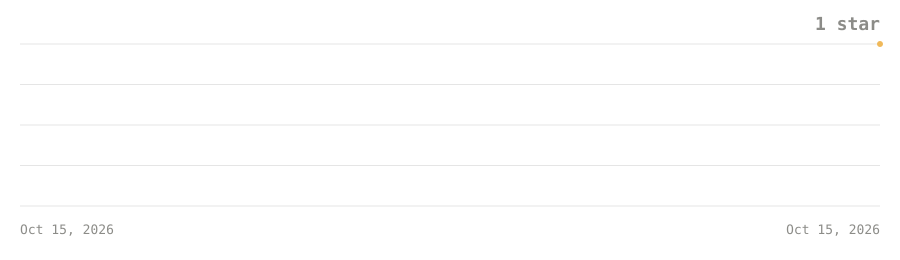

# Star Code

[](https://github.com/Star-Code-Prod/Star-Code/releases) [](https://github.com/Star-Code-Prod/Star-Code/blob/main/desktop/LICENSE) [](https://github.com/Star-Code-Prod/Star-Code)

**Website:** https://star-code-prod.github.io/Star-Code/

**A local, provider-agnostic agentic coding tool — a desktop app called Star and a terminal CLI, Star Code.**

Star Code is the harness, not the model: bring your own (DeepSeek, OpenAI,
Anthropic, Ollama, or any OpenAI-compatible endpoint) and it reads, searches,
edits, and runs commands in your project — asking before it touches anything.
Local MCP servers plug in too: their tools join the agent under the same
permission prompts. When the agent needs a decision it can ask with clickable
options in the conversation - you answer with a click, not a paragraph. The
desktop app is **Star**; the terminal CLI is **Star
Code**. Both share the same agent, web UI and credential store — and the CLI
needs no server at all.

## Layout

- **`desktop/`** — the Star app: Electron desktop shell, the local server
  (`server.js`), the web UI, and the CLI sources (`desktop/bin/star-code.mjs`,
  `desktop/lib/`). The same server/UI runs in a plain browser.
- **`CLI/`** — the standalone `star-code-cli` npm package. Its `bin/` and
  `lib/` are synced from `desktop/` — desktop is the source of truth.

## Quick start

### Star (desktop)

On Windows, double-click `desktop\start.bat` — it uses Electron when it is
installed and falls back to the browser when it is not. Or run from source:

```bash
cd desktop
npm install
npm run electron      # the Star desktop app
npm start             # or just the server + UI: http://localhost:4180
```

### Star Code (CLI)

Download the packaged CLI from the
[GitHub Releases page](https://github.com/Star-Code-Prod/Star-Code/releases) —
`star-code-cli-<version>.tgz` (install with
`npm i -g ./star-code-cli-<version>.tgz`) or `star-code-cli-<version>.zip`
(extract and run `node bin/star-code.mjs`). Or build from source:

```bash
cd CLI
npm i -g .            # installs the `star-code` command
star-code "fix the failing test"
```

## Documentation

Full feature documentation — tools, permission modes, providers, keyboard
shortcuts, architecture, security, builds and releases — lives in
[`desktop/README.md`](desktop/README.md).

## Star history

[](https://github.com/Star-Code-Prod/Star-Code)

Our own chart, drawn from the GitHub stargazers API by
[`desktop/tools/make-star-chart.mjs`](desktop/tools/make-star-chart.mjs) and
refreshed daily by CI — no third-party chart service involved.

## License

MIT — see [`desktop/LICENSE`](desktop/LICENSE).
