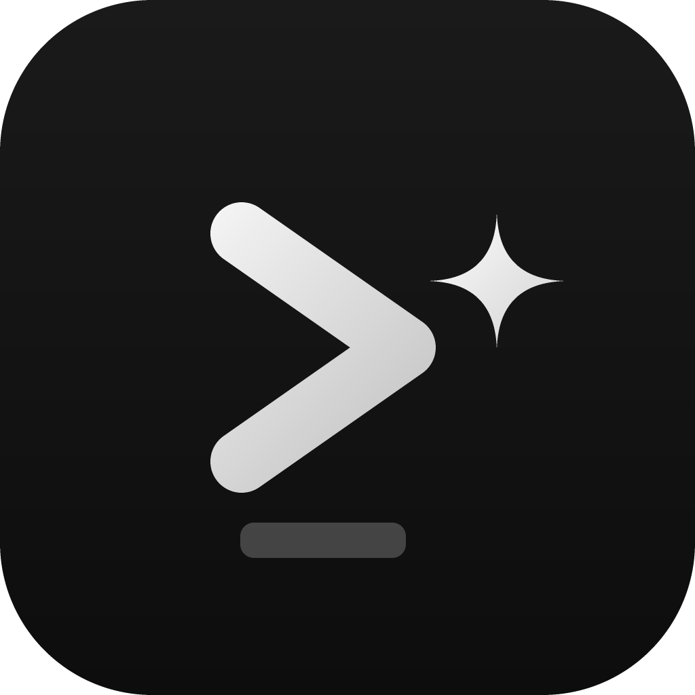
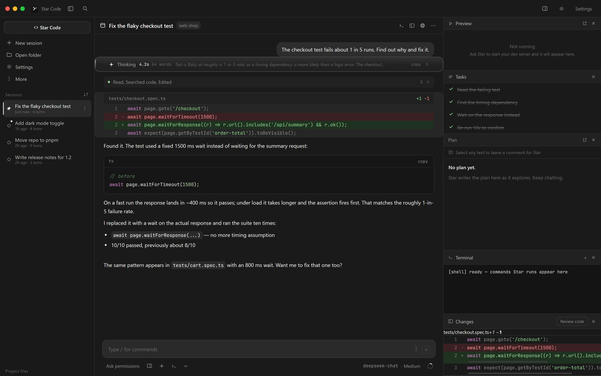

<div align="center">



# Star — desktop & CLI

**A local, provider-agnostic agentic coding agent — as a desktop app and a terminal CLI.**

Bring your own model. Star reads, searches, edits, and runs commands in your
project — and asks before it touches anything.

[](https://github.com/Star-Code-Prod/Star-Code/actions/workflows/build.yml)
[](LICENSE)
[](#install)
[](https://nodejs.org)



</div>

---

## Why

Most coding agents lock you into one vendor. Star is just the harness: the
tools, the permission model, the diff review, the desktop shell. The model is a
setting you change — including a model running on your own machine.

- **No telemetry, no accounts.** Your key goes to your provider, nothing else.
- **No cloud.** The server runs on `127.0.0.1` and dies with the app.
- **Real tools**, not a chat wrapper: it actually reads and writes your files.

## Features

| | |
|---|---|
| **16 real tools** | `read_file` `list_dir` `search_files` `glob_files` `write_file` `edit_file` `multi_edit` `run_command` `download` `search_knowledge` `task` `fetch_url` `websearch` `self_knowledge` `ask_user` `skill` |
| **Clickable questions** | `ask_user` asks 1-4 questions with 2-4 options each — the card renders in the conversation, the recommended option first, and a click is the answer (several questions pick, then Submit) |
| **Subagent missions** | `task` runs read-only research subagents with fresh context; several missions in one step run in parallel, and personas can never lose them |
| **Skills** | SKILL.md packs (the opencode format) from `.star-code/skills/`, `~/.star-code/skills/` or extra paths — the prompt carries the catalog, the `skill` tool loads one on demand, subagents can follow them too |
| **Plugins** | Local JS modules in `~/.star-code/plugins` — event hooks (turn/tool), custom tools the agent can call (permission-first), extra skill folders and agents. Broken plugins report in Settings instead of breaking the boot |
| **Artifacts** | ` ```artifact ` html/svg/md blocks render in a sandboxed preview pane with version history |
| **Knowledge** | Markdown notes in `.star-code/knowledge` — indexed in the prompt, searchable by the agent |
| **Custom agents** | Markdown personas in `.star-code/agents/` — the `task` tool runs them as read-only subagents, and the composer's agent chip (or `/agents`) runs one as the turn's persona: its prompt, its tools and its model |
| **MCP servers** | Local Model Context Protocol servers in Settings → MCP — Star starts them, their tools join the agent as `mcp__server__tool`, and every call asks permission first |
| **Permission modes** | Ask permissions · Accept edits · Plan (read-only) · Bypass |
| **Diff review** | Syntax-highlighted inline diffs, plus a Changes pane |
| **Reasoning view** | Live thinking block with a timer, auto-collapses when the answer starts |
| **Task checklist** | The model maintains its own plan and updates it as it works |
| **Context meter** | Live usage ring, e.g. `Context 20.1k / 200.0k (10%)` |
| **Connect-first setup** | 13 providers out of the box — paste a key, then pick from the model list that key can actually use |
| **Local runtimes** | Ollama, LM Studio and vLLM are detected automatically; no key, no URL typing |
| **Project files** | Sidebar tree; click a file to preview it, syntax-highlighted |
| **Slash commands** | `/clear` `/compact` `/init` `/diff` `/context` `/status` `/memory` `/plan` `/review` `/btw` `/model` `/models` `/connect` `/agents` `/knowledge` `/theme` `/settings` `/export` `/help` |
| **Input modes** | `@` mention a file · `!` run a shell command · `/` commands |
| **Themes** | Dark · Light · System |
| **In-app updates** | When a newer release exists, the banner installs it in place — download, sha512 check, silent install, relaunch |
| **Panes** | Tabbed right rail: Preview · Tasks · Plan · Terminal · Changes — badges, full-height, closable |

## Install

### Prebuilt

Grab an installer from [Releases](https://github.com/Star-Code-Prod/Star-Code/releases):

| Platform | File |
|---|---|
| Windows | `Star-Setup-<version>.exe` (installer) or `Star-<version>-portable.exe` |
| Windows (CLI) | `Star-Code-CLI-<version>.exe` — standalone `star-code`, no Node needed |
| macOS | `Star-<version>-arm64.dmg` |
| Linux | `Star-<version>-x86_64.AppImage` or `Star-<version>-amd64.deb` |

Builds are unsigned, so your OS will warn you on first launch.

### From source

```bash
git clone https://github.com/Star-Code-Prod/Star-Code.git
cd Star-Code
npm install
npm run electron      # desktop app
```

Or run it in a browser with no install beyond Node:

```bash
npm start             # http://localhost:4180
```

On Windows you can also just double-click `start.bat` — it uses Electron when
present and falls back to the browser when it isn't.

## Setup

1. Open **Settings** (`Ctrl+,`) → **Providers** — or type `/connect`
2. Pick a provider, paste its API key, hit **Connect**. It validates against
   the provider and shows the real error if anything is wrong
3. Choose a model with the picker (`/models`) — the list comes from the
   provider itself, so it is exactly what your key can use
4. **Session** → **Browse…** to choose the folder Star works in

Ollama, LM Studio and vLLM need no setup: if one is running it shows up as
**Detected** and its models join the picker.

Credentials live on this machine in `~/.star-code/auth.json` (or
`$STAR_CODE_DATA`), written `0600` where the OS supports it. Environment
variables (`OPENAI_API_KEY`, `ANTHROPIC_API_KEY`, …) are honored as a
fallback. Keys only ever go to the provider they belong to.

### Providers

| Provider | Base URL | Env var |
|---|---|---|
| OpenAI | `https://api.openai.com/v1` | `OPENAI_API_KEY` |
| Anthropic | `https://api.anthropic.com/v1` | `ANTHROPIC_API_KEY` |
| DeepSeek | `https://api.deepseek.com` | `DEEPSEEK_API_KEY` |
| Google (Gemini) | `https://generativelanguage.googleapis.com/v1beta/openai` | `GEMINI_API_KEY` / `GOOGLE_API_KEY` |
| xAI (Grok) | `https://api.x.ai/v1` | `XAI_API_KEY` |
| Groq | `https://api.groq.com/openai/v1` | `GROQ_API_KEY` |
| Mistral | `https://api.mistral.ai/v1` | `MISTRAL_API_KEY` |
| OpenRouter | `https://openrouter.ai/api/v1` | `OPENROUTER_API_KEY` |
| Together | `https://api.together.xyz/v1` | `TOGETHER_API_KEY` |
| Ollama | `http://localhost:11434/v1` | local, detected — no key |
| LM Studio | `http://localhost:1234/v1` | local, detected — no key |
| vLLM | `http://localhost:8000/v1` | local, detected — no key |
| Custom | any | `CUSTOM_API_KEY` |

The **base URL is per provider and fully honored** — point it at a proxy or a
local model server under *Advanced* and it uses that.

## Custom agents

A custom agent ("persona") is one markdown file: frontmatter (`name`,
`description`, optional `tools:` and `model:`) plus the prompt body. Drop files
in `.star-code/agents/` inside a project, or in `~/.star-code/agents/` to have
them everywhere. The desktop lists them in the composer's agent chip and
`/agents`; the CLI lists them with `/agents`. The desktop's list follows the
session's own folder — user-level agents always, project agents from the
session's project — so the row you click is the file the turn will run.

Picking one applies it to the next turns: its prompt goes in front of the
system prompt, `tools:` narrows (never widens) what the session may call, and a
`model: provider/model` line switches the turn to that provider. The builtin
`explorer` (read-only, no model) is always listed; **No agent** is the default.
The choice is client-side only — if the file disappears between picking and
sending, the turn just runs without a persona. The `task` tool takes the same
names (`agent: "reviewer"`), so one file can be both a subagent and a persona.
Broken files are skipped — the picker counts them, and the CLI's `/agents`
names the reason for each.

## MCP servers

Star speaks the Model Context Protocol to **local** servers — the same kind
opencode configures. Open **Settings → MCP**, add a command (for example
`uvx mcp-server-fetch` or `npx -y @modelcontextprotocol/server-memory`), and
Star launches it, handshakes over stdio JSON-RPC and lists its tools. They
reach the agent as `mcp__server__tool` beside the built-in tools, every call
asking permission first; plan mode blocks them, bypass allows them. Servers
come up at boot, are tested with the **Test** button, and are killed after
15 idle minutes.

Servers live in `~/.star-code/mcp.json` (a project may add its own in
`.star-code/mcp.json`, which wins by name). The file accepts both Star's
`servers` key and opencode's `mcp` key verbatim, so importing an opencode
install brings its servers along — remote (`url`) servers are listed as
skipped until Star speaks that transport. In the CLI, `/mcp` shows the
servers, their state and their tools.

## Skills

Skill packs are folders with a `SKILL.md` — frontmatter `name` and
`description`, a body of exact instructions — the same shape opencode uses.
Star reads `<project>/.star-code/skills/`, `~/.star-code/skills/`, plugin
folders and any extra paths from **Settings → Skills** (kept in
`~/.star-code/skills.json`). The system prompt carries the catalog, the
`skill` tool loads one on demand and returns its body plus its folder's
resource files, and subagents can load skills too. Importing an opencode
install brings its `skills.paths` along, so existing skill collections (a
modding toolkit, a writing workflow) just work.

## Plugins

Plugins are local JS modules that extend Star itself. Put a `.js`/`.mjs`
file into `~/.star-code/plugins/`, or point at files and folders from
**Settings → Plugins** (kept in `~/.star-code/plugins.json`). A plugin's
default export receives one object:

```js
export default function (star) {
  star.on("tool_call", (e) => { /* turn_start, turn_end, tool_call, tool_result */ });
  star.addTool({ name: "my_tool", description: "…", schema: { q: "string" }, run: ({ q }) => "…" });
  star.addSkillDir("C:\\my-skills");
  star.addAgent({ name: "my-agent", description: "…", prompt: "…" });
}
```

Plugin tools ask permission before every call (a plugin may declare
`dangerous: false` to skip the ask outside plan mode), are available to code
sessions — not Chat — and are never offered to subagents. Hooks are
fire-and-forget; a handler error lands on the plugin's Settings row, and a
broken plugin reports there instead of breaking the boot. Plugins are local
code running with Star's own privileges: only load what you trust. opencode
plugins are written against the opencode SDK and cannot be imported — the
importer says so per entry.

## Star Code CLI

Everything the desktop app does to your project, without the window:

```bash
npm run cli                                  # from a checkout (or: npm i -g . once)
star-code "fix the failing test"             # one-shot: streams the answer, then exits
star-code                                    # interactive session
star-code --model openai/gpt-4o --mode plan  # flags: --mode, --model, --root
```

Interactive mode has `/help`, `/model`, `/connect`, `/knowledge`, `/agents`,
`/mcp`, `/clear`, `/status` and `/exit`; permissions prompt inline (`y` once,
`n` no, `a` for the session). It runs the same agent loop, tools, credential
store and knowledge folder as the desktop app — no server, no extra
dependencies.

## Permission modes

Cycle with `Shift+Tab`, or pick one from the composer.

| Mode | Reads | Edits | Commands |
|---|---|---|---|
| **Ask permissions** | auto | asks | asks |
| **Accept edits** | auto | auto | asks |
| **Plan** | auto | **blocked** | **blocked** |
| **Bypass** | auto | auto | auto |

Local reads are always free. The network tools (`fetch_url`, `websearch`) ask
like edits and are blocked in plan mode; `multi_edit` asks like any edit; the
`task` tool runs a **read-only explorer** — it can read, search and report,
never write, and never leaves the machine. Plan mode hard-blocks every
mutating tool, so the model physically cannot write while you review its
approach.

## Keyboard shortcuts

| Key | Action |
|---|---|
| `Ctrl+,` | Settings |
| `Ctrl+N` | New session |
| `Shift+Tab` | Cycle permission mode |
| `Ctrl+O` | Toggle panes |
| `Ctrl+Shift+T` | Cycle theme |
| `Ctrl+L` | Clear transcript |
| `Esc` | Stop the response / close menus |
| `Enter` / `Shift+Enter` | Send / newline |

## Build your own installers

```bash
npm run pack        # unpacked app, for testing
npm run dist        # Windows: NSIS installer + portable .exe
npm run dist:mac    # macOS: dmg + zip
npm run dist:linux  # Linux: AppImage + deb
npm run dist:all    # all three (needs the right host OS for signing)
```

Output lands in `release/`.

### Releasing

Releases are automatic. **You only bump the version:**

```bash
npm version 1.2.0 --no-git-tag-version   # or edit package.json
git commit -am "1.2.0"
git push
```

The `Build & Release` workflow then:

1. runs the checks (`tools/verify-*.mjs`)
2. builds Windows, macOS and Linux
3. **tags `v1.2.0` only if that tag does not already exist**
4. publishes a GitHub release with all installers attached

A broken build can never ship — the `tag` job runs only after every platform
builds successfully.

To re-publish a version that already has a tag, use **Actions → Build &
Release → Run workflow** (the `publish` input defaults to true).

Once per release is plenty; pushing several commits without a version change
just rebuilds without creating a second release.

### Windows build notes

Two things can bite you when building locally on Windows. Both are
electron-builder issues, not Star Code bugs — CI is unaffected.

**1. `Cannot create symbolic link … libcrypto.dylib`**

electron-builder unpacks a signing-tools bundle that contains macOS symlinks,
and Windows needs **Developer Mode** (or an elevated shell) to create those:

> Settings → System → For developers → **Developer Mode: On**

If you'd rather not, the symlinks are macOS-only and can be skipped:

```powershell
$seven = "node_modules\7zip-bin\win\x64\7za.exe"
$cache = "$env:LOCALAPPDATA\electron-builder\Cache\winCodeSign"
$src   = (Get-ChildItem "$cache\*.7z" | Select-Object -First 1).FullName
& $seven x $src "-o$cache\winCodeSign-2.6.0" "-x!darwin" -y
```

**2. `spawn UNKNOWN` while building the NSIS installer**

electron-builder runs the freshly-built installer once to extract its
uninstaller binary for signing. Some antivirus products block that, which
surfaces as `spawn UNKNOWN` in `computeScriptAndSignUninstaller`.

Skip it by building the portable target, which has no uninstaller:

```bash
npx electron-builder --win portable --x64
```

The installer target works normally on CI runners.

## Architecture

The renderer never touches your filesystem. Everything goes through a local
server that owns the tools.

```
┌────────────────────┐   SSE    ┌──────────────────────────┐
│  UI (Electron or   │ ◄──────► │  server.js  (127.0.0.1)  │
│  browser)          │  HTTP    │  ├─ lib/agent.js         │
└────────────────────┘          │  │   agent loop, modes   │
                                │  ├─ lib/tools.js         │
                                │  │  16 tools, real I/O   │
                                │  └─ lib/providers.js     │
                                │      5 provider adapters │
                                └──────────────────────────┘
                                           │
                                           ▼
                                    your project on disk
```

```
star-code/
├── server.js              HTTP + SSE, static host, exports startServer()
├── lib/
│   ├── auth.js            credential store (auth.json), masking, resolution
│   ├── providers.js       provider catalog, model discovery, streaming
│   ├── tools.js           the 16 tools
│   └── agent.js           agent loop, permission modes, reasoning, usage
├── public/index.html      the entire UI (no build step, no framework)
├── electron/
│   ├── main.cjs           window, native dialogs, theme sync
│   └── preload.cjs        the only bridge exposed to the page
├── assets/                logo + generated icons
├── tools/
│   ├── make-icons.mjs     dependency-free PNG/ICO rasterizer
│   ├── uishot.mjs         headless-browser screenshots (CDP, zero deps)
│   ├── smoketest.ps1      boot + serve verification
│   └── screenshot.ps1     renders the UI to a PNG
└── .github/workflows/     cross-platform CI + releases
```

**Zero runtime dependencies.** The server uses only Node built-ins, so there is
nothing to audit and nothing to keep patched. `electron` and `electron-builder`
are dev dependencies.

### How the agent loop works

1. Your message is appended to the session history
2. The model streams a reply; any ` ```tool ` block is parsed out
3. The tool's permission is checked against the active mode
4. If needed, the UI asks you; the stream pauses on a promise
5. The tool runs against real files, results go back to the model
6. Repeat until the model stops calling tools (max 25 steps)

Reasoning tokens come through as separate events so they can be displayed live
and collapsed independently of the answer.

## Diagnostics

```powershell
powershell -ExecutionPolicy Bypass -File tools\smoketest.ps1    # boot, serve, shut down
powershell -ExecutionPolicy Bypass -File tools\screenshot.ps1   # render the UI to app-shot.png
node tools\uishot.mjs http://127.0.0.1:4180 shot.png            # headless Chrome/Edge screenshot
```

Two env-gated flags in `electron/main.cjs` help when a window won't come to the
foreground (useful in CI and headless setups):

- `CCD_SHOT=<path>` — render the app's own `webContents` to a PNG and exit
- `CCD_DIAG=<path>` — dump renderer state and forward renderer console output

```powershell
$env:CCD_SHOT="$PWD\shot.png"; .\node_modules\electron\dist\electron.exe .
```

## Security

- **Writes and commands always ask**, unless you deliberately switch modes
- **Plan mode hard-blocks** every mutating tool server-side
- **Credentials stay local**: keys live in `~/.star-code/auth.json` (plaintext,
  per-user, `0600` where supported); the UI only ever sees a mask. Delete that
  file to revoke everything at once
- Electron runs with `contextIsolation: true` and `nodeIntegration: false`
- The page sees only the functions in `preload.cjs` — no `require`, no `fs`
- External links open in your system browser, never in-app
- The server binds to localhost and only lives as long as the app

This is a tool that runs commands on your machine. Read the permission prompts.
Don't run Bypass mode in a directory you care about.

## Contributing

Issues and PRs are welcome. The UI is a single HTML file with no build step, so
you can edit it and reload. Please keep the zero-runtime-dependency property
intact.

```bash
npm run electron     # dev loop: close and re-run to pick up server changes;
                     # UI changes just need a reload (Ctrl+R)
```

## License

[MIT](LICENSE).

Star Code is an independent tool. It is not affiliated with, endorsed by, or
sponsored by Anthropic, OpenAI, DeepSeek, or Ollama. "Claude" and "Claude Code"
are trademarks of Anthropic; "OpenAI" is a trademark of OpenAI, Inc.
